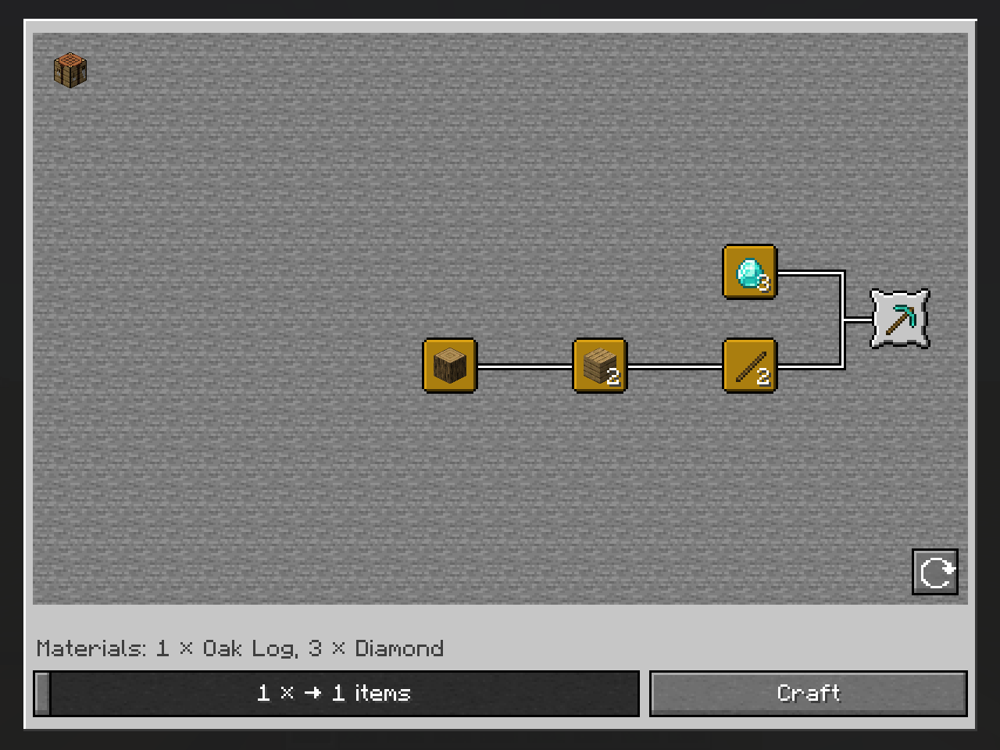
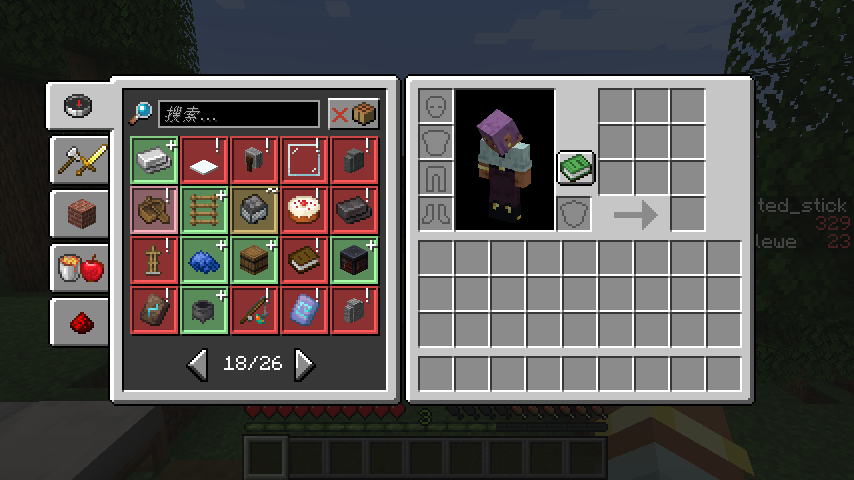

# Craftable

> Craft what you can, from what you have.

[简体中文](README.zh-CN.md) · [User guide](docs/user-guide.en.md) · [Documentation](docs/README.md)

Craftable enhances Minecraft's own Recipe Book. Craft with materials in your
inventory and nearby accessible containers, prepare intermediate ingredients,
and inspect the whole recipe chain without adding a storage network or a
separate recipe browser.

## What it does

- **Craft from your surroundings.** Use nearby resources and available
  workstations, while respecting container access and world rules.
- **Follow the recipe chain.** Inspect ingredients, choose supported alternatives,
  and review quantities before confirming a craft.
- **Prepare what is possible, explicitly.** Request partial preparation when the
  full target cannot be made; a failed normal craft never silently consumes
  materials for a partial result.
- **Keep the vanilla interface.** Survival and Adventure inventories gain a real
  3×3 crafting grid near an available crafting table. Placed crafting tables are
  enhanced too.
- **Let the server set the limits.** Personal preferences may tighten world rules,
  never relax them.

## A look inside

Review the route from logs to planks and sticks before making the final item.

The Recipe Book can recognize nearby resources even when the main inventory is
empty. The inventory example uses the Chinese interface.

## Requirements and installation

| Component | Target |
| --- | --- |
| Minecraft | Java Edition 1.21.1 |
| Loader | NeoForge; developed and tested with 21.1.235 |
| Java | 21 |

1. Use a matching Minecraft/NeoForge profile and a Craftable JAR built for it.
2. Put the JAR in the profile's `mods` folder. For multiplayer, install the same
   Craftable JAR on the server and every participating client.
3. Back up worlds and configuration before trying development builds, then open
   the Recipe Book in a Survival or Adventure inventory or crafting table.

Building from source? See the [developer guide](docs/developer-guide.en.md).

## Quick start

Hover a recipe in the Recipe Book, then use the default controls:

| Control | Action |
| --- | --- |
| **C** | Craft one complete batch of the selected recipe. |
| **When materials are insufficient, press and release C twice on the same target** | Explicitly request partial preparation; the first press attempts a full craft. |
| **Shift+C** | Inspect the chain, choose recipes and a craft count, then confirm. |

In the recipe chain view, **Maximum (MAX)** shows the highest number of complete
crafts found with the materials and inventory space available.

Normal left-click recipe placement still uses carried materials; use **C** for
nearby-container crafting. Key bindings can be changed in Minecraft's controls.

Open **Options → Accessibility Settings → Recipe Book** for personal settings and
world rules. Minecraft's mod list still calls the mod **Craftable**; its in-game
settings use **Recipe Book** terminology. Read the [user guide](docs/user-guide.en.md)
for whitelist modes, capacity, settings, and troubleshooting.

## Current limits

Craftable is in development. Current support is for ordinary crafting recipes,
not furnace processing, undo or general third-party machines.
Dropped items, entity inventories, and the contents of carried shulker boxes or
bundles are not crafting inputs. Creative and Spectator modes do not enable its
crafting capability.

Unknown or unfinished planning is not permission to craft. MAX may be a proven
lower bound rather than an exact maximum; more materials do not bypass inventory
space, permissions, or computation limits.

## Guides and license

- [User guide](docs/user-guide.en.md) · [中文用户指南](docs/user-guide.zh-CN.md)
- [Developer guide](docs/developer-guide.en.md) · [中文开发指南](docs/developer-guide.zh-CN.md)
- [Documentation hub](docs/README.md)

Maintained by **CraftableMC**. Licensed under the custom
[CraftableMC Community License 1.0](LICENSE), with a [Chinese translation](LICENSE.zh-CN).
It is source-available, not an OSI open-source license.

Free modpacks, noncommercial forks, monetized videos/streams, and donation-funded
or paid Minecraft servers are permitted within its conditions. Selling the mod,
charging for modified copies, and unauthorized commercial reuse of protected code
are not. Keep notices and identify redistributed modifications as unofficial.
Server fees do not authorize paywalled mod copies; media revenue does not waive
Mojang/Microsoft's rules. Important terms include termination, conditional cure,
and warranty/liability limits subject to mandatory law. Read the full license
before relying on its permissions.
