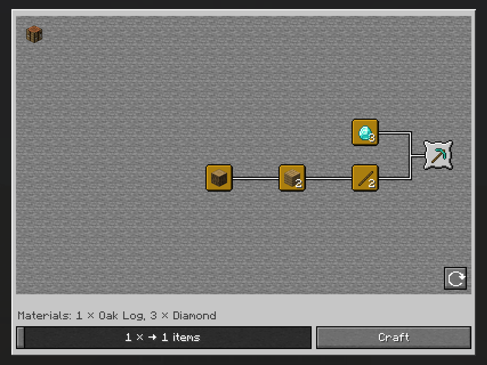
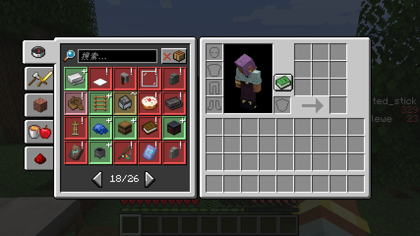

# Craftable（配方书）

> 强化配方书! 用现有材料，直接合成你想要的东西。

[English](README.md) · [用户指南](docs/user-guide.zh-CN.md) · [文档导航](docs/README.md)

Craftable 增强 Minecraft 原版配方书：直接使用背包和附近可访问容器的材料，
自动准备中间材料，并查看完整合成链。不增加存储网络，也不另造一个配方浏览器。

## 模组特色

- **从身边的资源合成。** 使用附近材料和可用工作站，同时遵守容器访问权限及世界规则。
- **看清完整配方链。** 查看投入、选择已支持的替代路线，并在确认前核对数量。
- **明确请求部分准备。** 无法完成目标时，可以主动请求准备当前能做的材料；普通合成失败不会悄悄消耗材料去做一部分。
- **保留原版界面。** 生存和冒险模式下，附近有可用工作台时，背包提供真实的 3×3 合成格；已放置工作台也获得增强。
- **世界规则由服务端决定。** 个人偏好只能进一步收紧，不能放宽世界限制。

## 界面示例

制作前查看原木、木板、木棍到最终物品的路线。

即使主背包为空，配方书也能识别附近资源。背包示例使用中文界面。

## 安装要求

| 项目 | 目标环境 |
| --- | --- |
| Minecraft | Java 版 1.21.1 |
| 加载器 | NeoForge；开发与测试版本为 21.1.235 |
| Java | 21 |

1. 使用匹配的 Minecraft/NeoForge 启动配置，以及为该环境构建的 Craftable JAR。
2. 将 JAR 放入对应配置的 `mods` 文件夹。多人游玩时，服务端和所有参与客户端安装同一份 Craftable JAR。
3. 体验开发构建前备份存档和配置，再在生存或冒险模式的背包或工作台打开配方书。

需要从源码构建时，见[开发指南](docs/developer-guide.zh-CN.md)。

## 快速上手

将鼠标指向配方书里的目标配方，使用默认按键：

| 操作 | 作用 |
| --- | --- |
| **C** | 完整合成一次当前配方。 |
| **缺料时，对同一目标按下并松开两次 C** | 明确请求部分准备；首击仍先尝试完整合成。 |
| **Shift+C** | 查看物品链、选择配方和合成次数，再明确确认。 |

物品链页面里的 **最多可合成（MAX）** 显示按当前可用材料和背包空间算出的最高完整合成次数。

普通左键填格仍使用随身材料；需要使用附近容器时按 **C**。按键可在原版控制设置修改。

从“选项 → 辅助功能设置 → 配方书”打开个人设置及世界规则。模组列表中的名称仍为
**Craftable**，游戏内设置使用“**配方书**”这一原版术语。白名单模式、空间、设置和
排错说明见[用户指南](docs/user-guide.zh-CN.md)。

## 当前限制

模组仍在开发中。当前支持普通合成配方，尚不支持炉类处理、撤销或通用
第三方机器。地面掉落物、实体库存、随身潜影盒及收纳袋的内部材料不是合成输入。
创造和旁观模式不启用本模组的合成能力。

未知或尚未算完的方案不授予制作权限。MAX 可能只是已证明可行的下界，而非精确上限；
材料更多也不能绕过背包空间、权限或计算限制。

## 指南与许可

- [中文用户指南](docs/user-guide.zh-CN.md) · [English User Guide](docs/user-guide.en.md)
- [中文开发指南](docs/developer-guide.zh-CN.md) · [English Developer Guide](docs/developer-guide.en.md)
- [文档导航](docs/README.md)

由 **CraftableMC** 维护。采用定制的 [CraftableMC Community License 1.0](LICENSE)，
附[中文译文](LICENSE.zh-CN)。这是源码可用许可，不是 OSI 开源许可。

在许可条件内允许免费整合包、非商业修改版、带收益的视频/直播，以及接受捐赠或收费的
Minecraft 服务器；不允许出售模组、收费提供修改版或未经授权商业复用受保护代码。
再分发须保留声明，修改版须标明非官方及修改情况。服务器收费不授权模组副本付费门槛，
媒体收益也不免除 Mojang/Microsoft 的规则。重要条款还包括许可终止、有条件整改恢复，
以及受强制法限制的担保和责任限制；请阅读完整许可后再依赖其授权。
